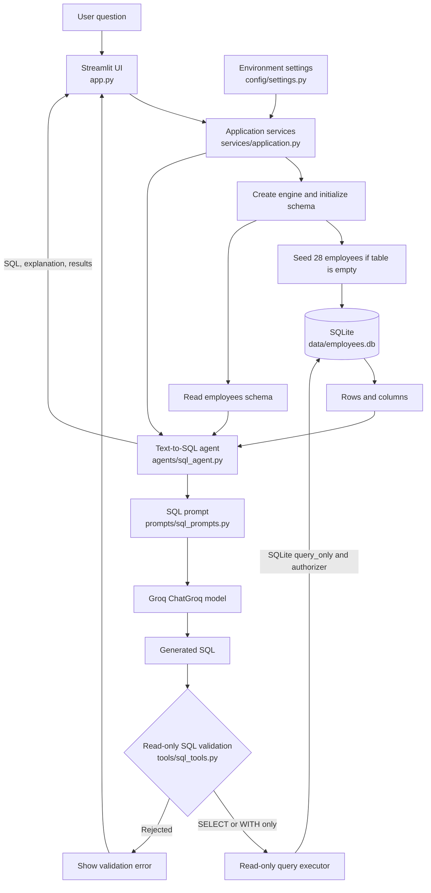

# Text-to-SQL HR Assistant

An AI-powered HR analytics assistant that converts natural-language questions into SQL queries using **LangChain and Groq LLM**.

This Streamlit application allows users to ask questions about employee data in plain English. It generates SQL queries, validates them to ensure read-only database access, executes them against a SQLite database, and presents the results in an easy-to-understand format.

## Features

- Natural-language questions about employee records.
- LangChain prompt/model pipeline with the existing Groq provider and model.
- Automatic schema creation and 28 fictional, repeatable sample employees.
- SQL and result display, row counts, loading feedback, and example questions.
- Pre-execution SQL validation, single-statement enforcement, result limits, and
  SQLite read-only authorizer/query-only protections.
- SQLAlchemy database layer, with `DATABASE_URL` available for future PostgreSQL
  configuration.
- Centralized logging that avoids logging API keys, prompts, or employee query
  results.

## Architecture

```text
app.py
  └── services/application.py     Compose and initialize application services
      ├── config/settings.py      Environment-backed configuration
      ├── database/               SQLAlchemy schema, connection, and seed data
      └── agents/sql_agent.py     LangChain SQL generation and orchestration
          ├── prompts/            SQL generation instructions
          └── tools/sql_tools.py  Validation and read-only query execution
```

SQL generation is intentionally separate from SQL execution. The former
`create_sql_agent` exposed database query tools directly to the model, making it
difficult to guarantee that every generated statement was validated before
execution. The new flow uses LangChain to generate one SQL statement, validates
it in application code, and only then executes it. SQLite additionally denies
all non-read operations and reads from tables other than `employees`.

The Streamlit entry point handles presentation and delegates database setup,
agent construction, and query execution to independent modules. The database
package does not import Streamlit, and the agent can be exercised without the UI.

### Runtime architecture diagram



For a future PostgreSQL deployment, configure SQLAlchemy with `DATABASE_URL` and
use a database account with read-only permissions. The query executor also marks
PostgreSQL transactions as read-only.

## Folder structure

```text
.
├── app.py
├── agents/
│   └── sql_agent.py
├── config/
│   └── settings.py
├── database/
│   ├── connection.py
│   ├── schema.py
│   └── seed.py
├── data/
│   └── employees.db             # Created automatically on first run
├── prompts/
│   └── sql_prompts.py
├── services/
│   └── application.py
├── tests/
│   └── test_sql_tools.py
├── tools/
│   └── sql_tools.py
└── utils/
    └── logger.py
```

## Technology stack

- Python 3.10+
- Streamlit
- LangChain Core and `langchain-groq`
- SQLAlchemy 2.x
- SQLite (initial database)
- pandas
- python-dotenv

## Installation

### Windows

From the project directory:

```powershell
python -m venv .venv
.venv\Scripts\activate
pip install -r requirements.txt
```

### Linux/macOS

From the project directory:

```bash
python3 -m venv .venv
source .venv/bin/activate
pip install -r requirements.txt
```

## Environment variables

Copy `.env.example` to `.env` and set your Groq API key:

```dotenv
GROQ_API_KEY=your_groq_api_key
GROQ_MODEL=openai/gpt-oss-120b
DATABASE_URL=
MAX_RESULT_ROWS=500
```

`GROQ_MODEL` defaults to the model used by the original app. `DATABASE_URL` is
optional; leaving it blank selects the local SQLite file. Do not commit `.env`,
API keys, or a production database. The provided `.gitignore` excludes these
files.

### Render deployment

Render does not automatically upload the local `.env` file. In the Render
dashboard, open the app's web service, go to **Environment**, and add
`GROQ_API_KEY` with your Groq API key as its value. Save the change and redeploy
the service. Keep the key in Render's environment settings; do not commit it to
the repository.

## Database initialization

On application startup, SQLAlchemy creates the `employees` table and its manager
foreign key if they do not already exist. The seed module inserts its 28 sample
records only when the table is empty, so restarting the app does not duplicate
the initial data.

The schema is:

| Column | Type | Description |
| --- | --- | --- |
| `id` | Integer | Auto-increment primary key |
| `first_name` | String | Employee first name |
| `last_name` | String | Employee last name |
| `email` | String | Unique fictional email address |
| `department` | String | Department |
| `designation` | String | Job title |
| `salary` | Decimal | Annual salary |
| `joining_date` | Date | Date of joining |
| `city` | String | Employee location |
| `manager_id` | Integer, nullable | Self-reference to `employees.id` |

The database file is created the first time the app starts. For PostgreSQL,
install a SQLAlchemy-compatible PostgreSQL driver and set `DATABASE_URL` to a
PostgreSQL connection URL. Use a database account with read-only query
permissions in production.

The 28 sample employees are fictional and use Indian names and Indian cities.
Examples include Priya Sharma in Mumbai, Arjun Mehta in Bengaluru, and Rahul
Nair in Chennai. Other sample locations include Pune, Hyderabad, Delhi, Kolkata,
Kochi, and Jaipur.

## Run the application

```bash
streamlit run app.py
```

The sidebar shows database information, the available tables, the employee
schema, and selectable example questions. The main panel accepts a question and
displays the generated SQL, a short clause-level explanation, the result table,
and its row count.

## Sample questions

- Who are the five highest-paid employees?
- Find employees working in the Engineering department.
- List employees who joined after 2022.
- What is the average salary by department?
- Which city has the highest number of employees?
- Who earns more than the average salary?
- Who reports to employee 2?
- Count employees in each department.
- Which employees joined in the last two years?

## How a question is processed

1. The agent provides the employee schema and current date to the LangChain
   prompt/model pipeline.
2. The model returns one SQL statement.
3. The SQL validator permits only `SELECT`/`WITH` statements, blocks dangerous
   operations, and rejects semicolons/multiple statements.
4. The SQLite executor enables `query_only`, restricts reads to the employees
   table, and caps returned rows.
5. The UI displays the generated SQL, an explanation of its clauses, and the
   results. Generation, validation, and database errors are reported separately.

## Security considerations

- Store API keys in `.env` locally or in the deployment platform's secret store.
- Do not put credentials in source files or share `.env`.
- Generated SQL is validated before execution; the agent does not receive a
  direct database mutation tool.
- SQLite execution uses `PRAGMA query_only` and a connection authorizer that
  denies writes and reads outside `employees`.
- Keep production database credentials read-only. For PostgreSQL, the app also
  marks each query transaction read-only; database-level grants remain the
  essential control.
- Sample employee names, emails, and Indian locations are fictional. Do not use
  this sample app with real HR data without authentication, authorization,
  privacy controls, audit policy, and a security review.
- SQL results are capped by `MAX_RESULT_ROWS` (1–5000).

## Tests

Run the focused standard-library tests with:

```bash
python -m unittest discover -s tests -v
```

## Future enhancements

- Add authentication and role-based column/table access.
- Add PostgreSQL integration tests and deployment configuration.
- Add query evaluation fixtures to measure SQL correctness and safety.
- Add charts for aggregate results and an audit-friendly request trace.
- Add a separate, permission-aware HR policy RAG workflow.
