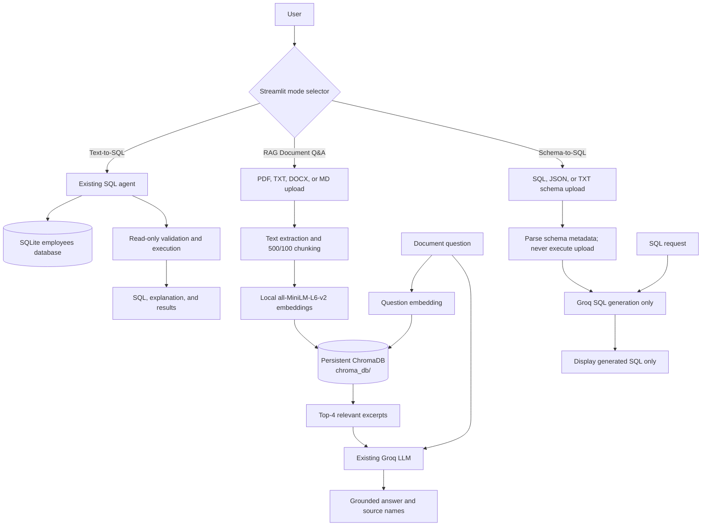

# Text-to-SQL HR Assistant

An AI-powered HR analytics assistant that converts natural-language questions into SQL queries using **LangChain and Groq LLM**.

This Streamlit application provides three separate workflows: guarded SQL
generation and execution against a sample employee database, document-grounded
question answering with local embeddings, and SQL generation from an uploaded
schema without executing the generated statement.

## Features

- Natural-language questions about employee records.
- LangChain prompt/model pipeline with the existing Groq provider and model.
- Document question answering with local Sentence Transformers embeddings and
  persistent ChromaDB retrieval.
- Schema upload (SQL, JSON, or text) for SQL generation without validation or
  execution.
- Three isolated modes: Text-to-SQL, RAG Document Q&A, and Schema-to-SQL.
- Automatic schema creation and 28 fictional, repeatable sample employees.
- SQL and result display, row counts, loading feedback, and example questions.
- Pre-execution SQL validation, single-statement enforcement, result limits, and
  SQLite read-only authorizer/query-only protections.
- SQLAlchemy database layer, with `DATABASE_URL` available for future PostgreSQL
  configuration.
- Centralized logging that avoids logging API keys, prompts, or employee query
  results.

## Architecture

```text
app.py
  ├── Text-to-SQL
  │   └── services/application.py    Initialize SQLite and the guarded SQL agent
  │       ├── database/              SQLAlchemy schema and seed data
  │       └── tools/sql_tools.py     Read-only validation and execution
  ├── RAG Document Q&A
  │   └── services/rag_service.py    Extract, chunk, embed, index, retrieve, answer
  │       ├── services/document_loader.py
  │       ├── services/embedding_service.py
  │       └── services/vector_store.py  Persistent ChromaDB collection
  └── Schema-to-SQL
      ├── services/schema_parser.py  Parse uploaded schema metadata
      └── services/sql_generator.py  Generate SQL only; no DB or executor
```

The existing Text-to-SQL workflow keeps SQL generation separate from SQL
execution: it validates generated SQL in application code before read-only
execution. Schema-to-SQL is a separate generation-only service with no database
engine, validator, or executor dependency. Document Q&A uses its own persistent
Chroma collection and does not initialize the employee database.

The Streamlit entry point handles presentation and delegates database setup,
agent construction, and query execution to independent modules. The database
package does not import Streamlit, and the agent can be exercised without the UI.

### Runtime architecture diagram



For a future PostgreSQL deployment, configure SQLAlchemy with `DATABASE_URL` and
use a database account with read-only permissions. The query executor also marks
PostgreSQL transactions as read-only.

## Folder structure

```text
.
├── app.py
├── agents/
│   └── sql_agent.py
├── config/
│   └── settings.py
├── database/
│   ├── connection.py
│   ├── schema.py
│   └── seed.py
├── data/
│   └── employees.db             # Created automatically on first run
├── prompts/
│   ├── rag_prompts.py
│   ├── schema_sql_prompts.py
│   └── sql_prompts.py
├── services/
│   ├── application.py
│   ├── document_loader.py
│   ├── embedding_service.py
│   ├── rag_service.py
│   ├── schema_parser.py
│   ├── sql_generator.py
│   └── vector_store.py
├── chroma_db/                   # Persistent RAG vectors; created automatically
├── examples/
│   ├── rag/
│   └── schemas/
├── tests/
│   ├── test_document_rag.py
│   ├── test_schema_parser.py
│   ├── test_sql_generation.py
│   └── test_sql_tools.py
├── tools/
│   └── sql_tools.py
└── utils/
    └── logger.py
```

## Technology stack

- Python 3.10+
- Streamlit
- LangChain Core and `langchain-groq`
- ChromaDB and Sentence Transformers (`sentence-transformers/all-MiniLM-L6-v2`)
- pypdf, python-docx, and SQLGlot
- SQLAlchemy 2.x
- SQLite (initial database)
- pandas
- python-dotenv

## Installation

### Windows

From the project directory:

```powershell
python -m venv .venv
.venv\Scripts\activate
pip install -r requirements.txt
```

### Linux/macOS

From the project directory:

```bash
python3 -m venv .venv
source .venv/bin/activate
pip install -r requirements.txt
```

## Environment variables

Copy `.env.example` to `.env` and set your Groq API key:

```dotenv
GROQ_API_KEY=your_groq_api_key
GROQ_MODEL=openai/gpt-oss-120b
DATABASE_URL=
MAX_RESULT_ROWS=500
CHROMA_PERSIST_DIRECTORY=chroma_db
```

`GROQ_MODEL` defaults to the model used by the original app. `DATABASE_URL` is
optional; leaving it blank selects the local SQLite file. Do not commit `.env`,
API keys, or a production database. The provided `.gitignore` excludes these
files.

### Render deployment

Render does not automatically upload the local `.env` file. In the Render
dashboard, open the app's web service, go to **Environment**, and add
`GROQ_API_KEY` with your Groq API key as its value. Save the change and redeploy
the service. Keep the key in Render's environment settings; do not commit it to
the repository. To retain indexed documents across deployments, mount a
persistent disk and set `CHROMA_PERSIST_DIRECTORY` to its mount path. The local
embedding model is downloaded when first needed, so allow enough disk and memory
for it on the service.

## Database initialization

On application startup, SQLAlchemy creates the `employees` table and its manager
foreign key if they do not already exist. The seed module inserts its 28 sample
records only when the table is empty, so restarting the app does not duplicate
the initial data.

The schema is:

| Column | Type | Description |
| --- | --- | --- |
| `id` | Integer | Auto-increment primary key |
| `first_name` | String | Employee first name |
| `last_name` | String | Employee last name |
| `email` | String | Unique fictional email address |
| `department` | String | Department |
| `designation` | String | Job title |
| `salary` | Decimal | Annual salary |
| `joining_date` | Date | Date of joining |
| `city` | String | Employee location |
| `manager_id` | Integer, nullable | Self-reference to `employees.id` |

The database file is created the first time the app starts. For PostgreSQL,
install a SQLAlchemy-compatible PostgreSQL driver and set `DATABASE_URL` to a
PostgreSQL connection URL. Use a database account with read-only query
permissions in production.

The 28 sample employees are fictional and use Indian names and Indian cities.
Examples include Priya Sharma in Mumbai, Arjun Mehta in Bengaluru, and Rahul
Nair in Chennai. Other sample locations include Pune, Hyderabad, Delhi, Kolkata,
Kochi, and Jaipur.

## Run the application

```bash
streamlit run app.py
```

Use the mode selector at the top to switch between:

- **Text-to-SQL:** Existing employee database workflow with validation and
  read-only execution.
- **RAG Document Q&A:** Upload PDF, TXT, DOCX, or Markdown documents, index them,
  and ask questions grounded in retrieved excerpts. The Chroma collection
  persists under `CHROMA_PERSIST_DIRECTORY`; duplicate file contents are not
  indexed again.
- **Schema-to-SQL:** Upload `.sql`, `.json`, or `.txt` schema and request SQL.
  This mode displays generated SQL only. It does not validate or execute it and
  does not initialize the employee database.

The Text-to-SQL sidebar shows database information, the employee schema, and
selectable example questions. Example files are provided in
[examples/rag/](./examples/rag/) and [examples/schemas/](./examples/schemas/).

### Schema upload formats

- `.sql` files should contain one or more `CREATE TABLE` statements. The app
  parses these statements as text and never runs them.
- `.json` files should use a top-level `tables` array or object. Each table
  defines `name` and `columns`; columns define `name`, `type`, and optional
  `primary_key` or `references` fields. See
  [company.json](./examples/schemas/company.json).
- `.txt` files may contain free-form schema descriptions. For structured
  metadata extraction, use headings such as `Table employees:` followed by
  lines such as `- id: INTEGER PRIMARY KEY` and
  `- department_id: INTEGER REFERENCES departments.id`.

## Sample questions

- Who are the five highest-paid employees?
- Find employees working in the Engineering department.
- List employees who joined after 2022.
- What is the average salary by department?
- Which city has the highest number of employees?
- Who earns more than the average salary?
- Who reports to employee 2?
- Count employees in each department.
- Which employees joined in the last two years?

## How a question is processed

### Text-to-SQL

1. The agent provides the employee schema and current date to the LangChain
   prompt/model pipeline.
2. The model returns one SQL statement.
3. The SQL validator permits only `SELECT`/`WITH` statements, blocks dangerous
   operations, and rejects semicolons/multiple statements.
4. The SQLite executor enables `query_only`, restricts reads to the employees
   table, and caps returned rows.
5. The UI displays the generated SQL, an explanation of its clauses, and the
   results. Generation, validation, and database errors are reported separately.

### RAG Document Q&A

1. Supported files are extracted as text; empty or unsupported documents are
   reported without indexing.
2. Text is split into 500-character chunks with 100-character overlap.
3. Sentence Transformers creates local embeddings; ChromaDB stores chunk text,
   source names, and content hashes in a persistent collection.
4. A question retrieves up to four relevant chunks. Groq answers only from the
   retrieved context and the UI displays source document names.
5. If retrieved chunks are not sufficiently relevant, the app reports that the
   uploaded documents do not contain the answer.

### Schema-to-SQL

1. SQL DDL, JSON table/column metadata, or a text schema description is parsed
   and supplied as context to Groq. The prompt requests one read-only `SELECT`
   query.
2. The model returns SQL text, which the UI displays with Streamlit's copy
   control.
3. This path has no database engine, SQL validator, or executor dependency.
   Uploaded DDL and generated SQL are never executed.

## Security considerations

- Store API keys in `.env` locally or in the deployment platform's secret store.
- Do not put credentials in source files or share `.env`.
- Generated SQL is validated before execution; the agent does not receive a
  direct database mutation tool.
- Schema-to-SQL is intentionally generation-only and is not an SQL safety
  validator. Review generated SQL before using it elsewhere.
- RAG uploads and Chroma vectors are stored persistently for this single-user
  deployment. Do not upload sensitive documents to a shared or publicly
  accessible instance.
- SQLite execution uses `PRAGMA query_only` and a connection authorizer that
  denies writes and reads outside `employees`.
- Keep production database credentials read-only. For PostgreSQL, the app also
  marks each query transaction read-only; database-level grants remain the
  essential control.
- Sample employee names, emails, and Indian locations are fictional. Do not use
  this sample app with real HR data without authentication, authorization,
  privacy controls, audit policy, and a security review.
- SQL results are capped by `MAX_RESULT_ROWS` (1–5000).

## Tests

Run the focused standard-library tests with:

```bash
python -m unittest discover -s tests -v
```

The test suite uses temporary Chroma collections and fake embeddings/LLM
responses, so it does not need a Groq call or a model download.

## Future enhancements

- Add authentication and role-based column/table access, including private
  per-user document libraries.
- Add PostgreSQL integration tests and deployment configuration.
- Add query evaluation fixtures to measure SQL correctness and safety.
- Add charts for aggregate results and an audit-friendly request trace.
